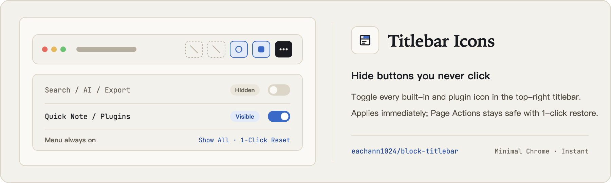

<picture>
  <source media="(prefers-color-scheme: dark)" srcset="assets/card-en-dark.png">
  <source media="(prefers-color-scheme: light)" srcset="assets/card-en-light.png">
  
</picture>

Much like customizing your Chrome or Safari toolbar, this plugin tucks away buttons you rarely use in the top-right corner of Block so your workspace stays clean and focused.

- **Toggle each button**: Show or hide both built-in actions and titlebar buttons added by other installed plugins.
- **Instant save**: Flip a switch in plugin settings and the titlebar updates right away.
- **Always easy to undo**: Page Actions stays pinned so you never lose the main menu, and a single click on Show All brings every button back.

**Install**: Open Block Settings -> App Store and search **Titlebar Icons**, or enter `blockmd-plugins/block-titlebar`.
