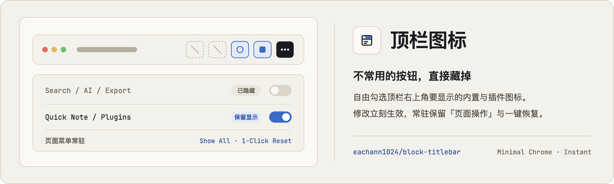

<picture>
  <source media="(prefers-color-scheme: dark)" srcset="assets/card-zh-dark.png">
  <source media="(prefers-color-scheme: light)" srcset="assets/card-zh-light.png">
  
</picture>

就像整理 Chrome 或 Safari 浏览器工具栏一样，把 Block 窗口右上角平时用不上的按钮收起来，只留下自己顺手的几个，写作界面更清爽。

- **按钮逐个开关**：无论是 Block 自带的功能按钮，还是其他已装插件加到顶栏的按钮，都能按需显示或隐藏。
- **改完立即生效**：在插件设置页拨动开关，顶栏立刻同步变化并自动记住。
- **主菜单不会丢失**：「页面操作」入口会始终为你保留，随时也可以点击「全部显示」一键找回所有按钮。

**安装**：打开 Block「设置 → 应用商店」搜索 **顶栏图标**，或手动填入 `blockmd-plugins/block-titlebar`。
